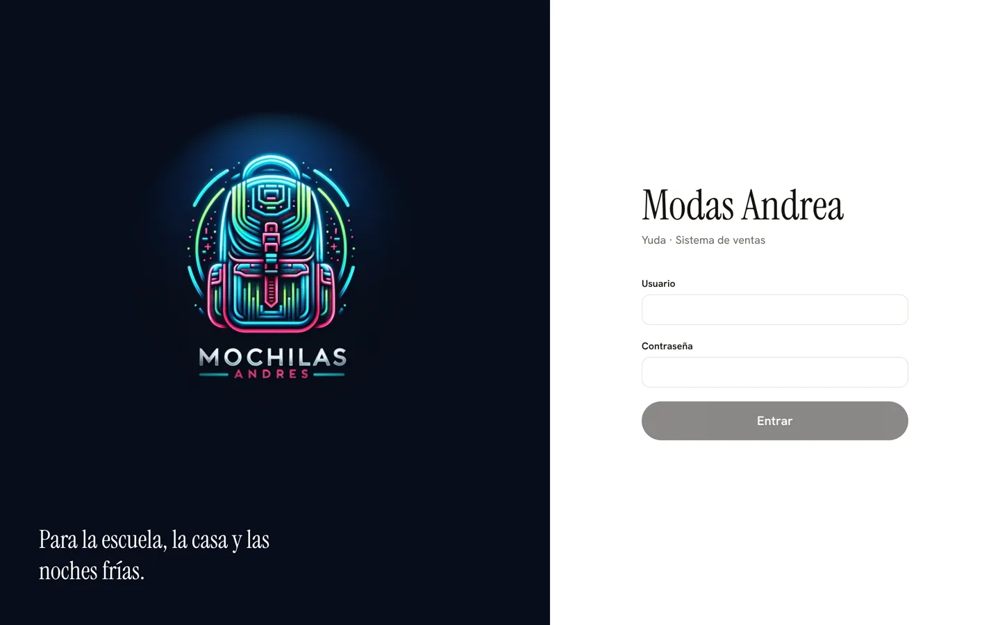
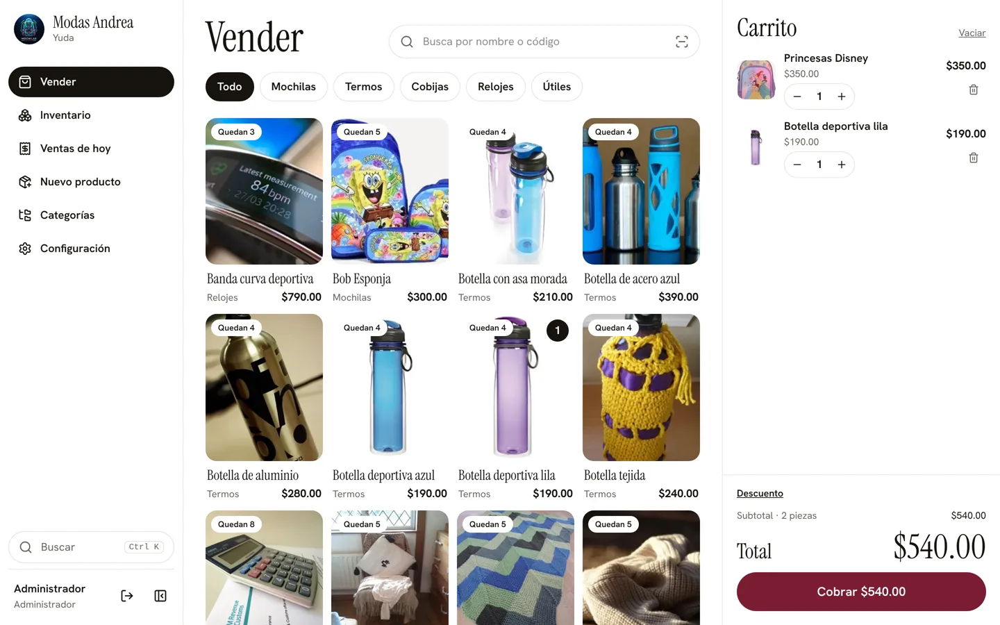
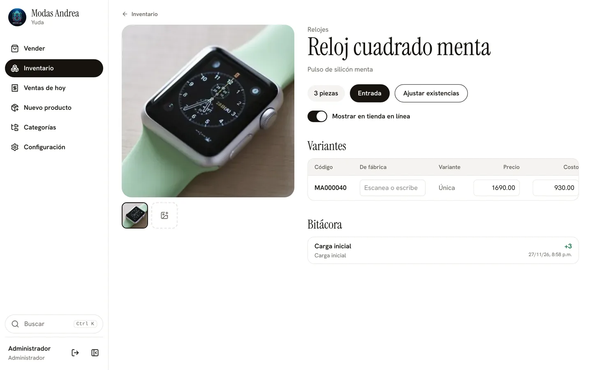
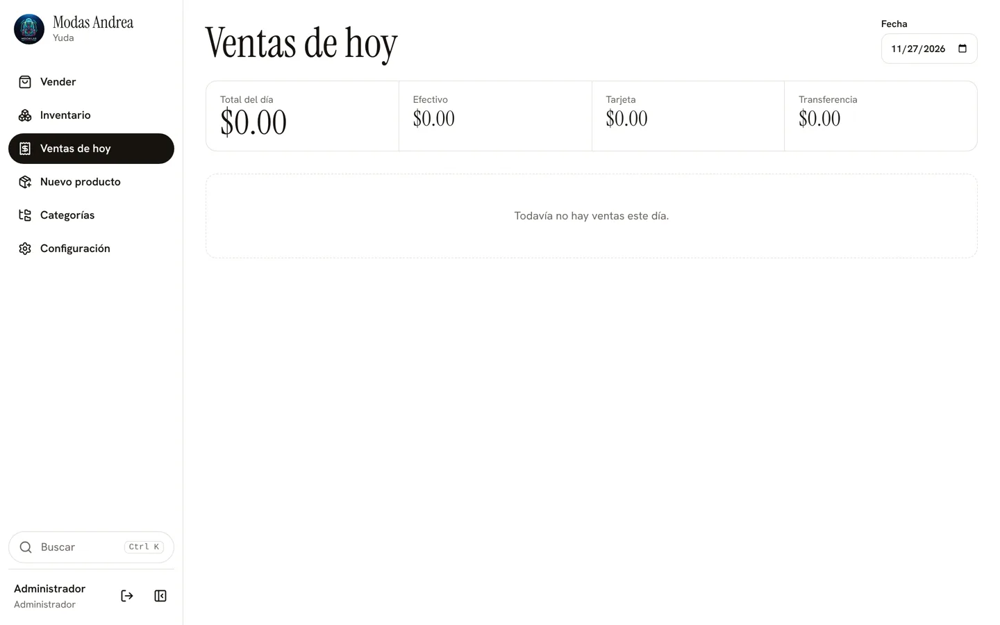
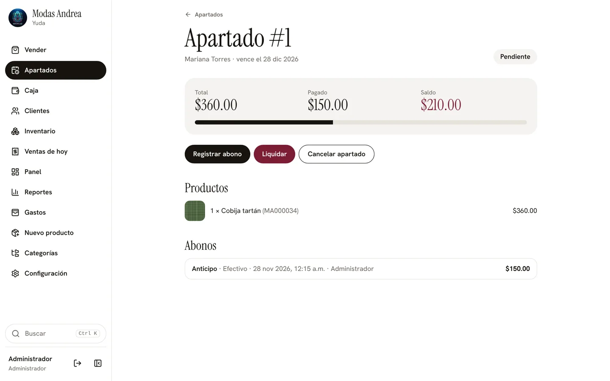
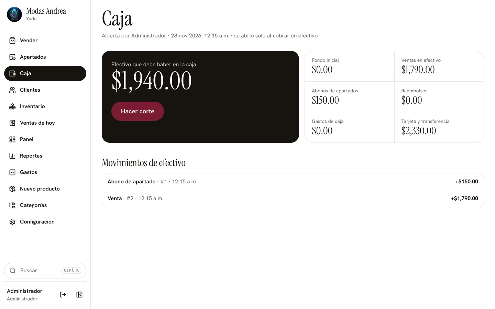
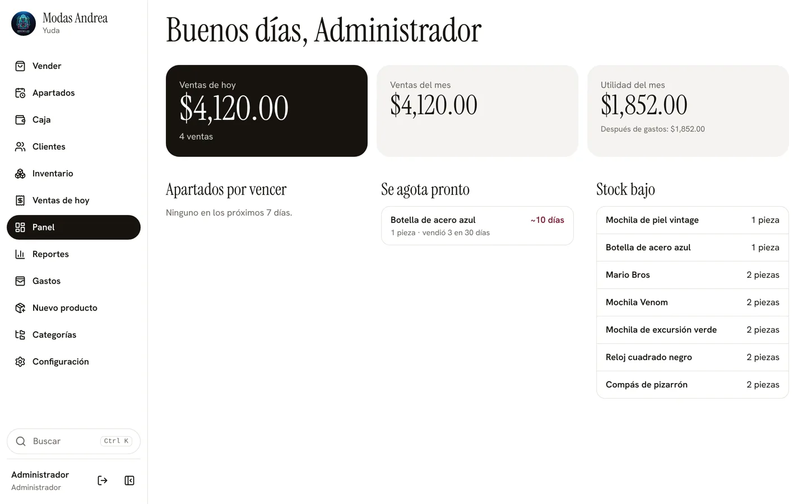

# Modas Andrea (Yuda)

Sistema de ventas para la tienda: catálogo con variantes y fotos, inventario con bitácora y punto de venta con carrito y pagos mixtos. La PC del negocio funciona como servidor y los demás dispositivos se conectan a ella.

> **Etapa 3 de 6.** Ya incluye la app para vender desde PC, tablet o celular, y la operación diaria: clientes con puntos y saldo a favor, apartados, devoluciones, gastos, caja con corte, reportes y panel. La conexión sin internet, las etiquetas, la cámara para leer códigos y la tienda en línea llegan en las siguientes etapas (ver `docs/superpowers/plans/`).

## 1. Instalación (Windows)

1. Copia la carpeta del sistema donde quieras, por ejemplo en `C:\ModasAndrea`.
2. Haz doble clic en **`instalar.bat`**. El instalador:
   - busca Python 3.12 o superior y, si no lo encuentra, lo instala con `winget`;
   - crea un entorno aislado (`.venv`) e instala las librerías de `requirements.txt`;
   - crea el archivo `.env` con una clave secreta aleatoria;
   - prepara la base de datos en `data\modas-andrea.db`;
   - te pregunta si quieres cargar el **catálogo de prueba** (58 productos con foto);
   - crea el acceso directo **Modas Andrea** en el escritorio.
3. Abre el sistema con **`aplicacion.bat`** o con el acceso directo.

### Usuarios iniciales

| Usuario    | Contraseña | Rol           |
|------------|------------|---------------|
| `admin`    | `admin123` | Administrador |
| `vendedor` | `12345`    | Vendedor      |

Cámbialas antes de usar el sistema en la tienda. Si se olvida una contraseña, usa **`restablecer_contrasena.bat`**.

## 2. Usar el sistema

Al abrir `aplicacion.bat` se abre el navegador en `http://127.0.0.1:5000`. Desde otra computadora, tablet o celular conectado a la misma red, abre la dirección que aparece como **En la red local** (por ejemplo `http://192.168.1.20:5000`).



### Vender

Toca un producto, escanéalo con el lector de códigos USB o búscalo con **Ctrl + K**. El carrito muestra el total. **Cobrar** abre el pago: efectivo (calcula el cambio), tarjeta, transferencia o mixto. El vendedor puede dar hasta 10 % de descuento; más que eso lo autoriza el administrador.




En el celular el carrito queda abajo y se abre con **Ver carrito**:


### Inventario

Cada producto tiene su ficha con fotos, variantes, precio, costo (solo administrador) y bitácora. **Entrada** suma piezas cuando llega mercancía; **Ajustar existencias** corrige el conteo y pide el motivo.



### Nuevo producto

Cuatro pasos: datos, precio (o variantes como colores y tallas), fotos y revisar. La cámara guía las tomas *Frente*, *Lado* y *Detalle*; si no hay cámara, usa **Elegir foto**. Al guardar recibe su código `MA######` y aparece en Vender.


> La cámara del navegador solo funciona en la misma computadora (`127.0.0.1`) o con un enlace seguro `https://` (etapa 4). Desde otros dispositivos en la red local usa **Elegir foto**, que abre la cámara del celular.

### Ventas del día

Lista de ventas con totales por forma de pago. El administrador puede **cancelar** una venta: las piezas regresan al inventario y la venta queda registrada como cancelada.



### Clientes

Toca **Cliente** en el carrito para buscarlo o registrarlo (nombre y teléfono). Cada compra suma 1 punto por cada $10. Si tiene **saldo a favor** (por una devolución o un apartado cancelado), aparece la pestaña **Saldo** al cobrar.

### Apartados

En Vender, agrega los productos, elige al cliente y toca **Apartar**: escribe el anticipo y la fecha límite (30 días por defecto). Las piezas salen del inventario para que nadie más las venda. En **Apartados** registras abonos, **liquidas** (se convierte en venta) o, como administrador, **cancelas**: las piezas regresan y el dinero se devuelve o queda como saldo a favor.



### Devoluciones

En **Ventas de hoy**, abre la venta y toca **Devolver piezas** (administrador): eliges cuántas piezas regresan y cómo se reembolsa. El monto se calcula con lo que se pagó por esas piezas.

### Caja

Al empezar el turno, **Abrir caja** con el fondo inicial. La pantalla muestra en vivo el efectivo que debe haber: fondo + ventas y abonos en efectivo − reembolsos − gastos pagados de la caja. Al terminar, **Hacer corte**: escribes lo que contaste y ves si cuadra, falta o sobra. Si alguien cobra en efectivo sin abrir caja, el sistema la abre solo con fondo $0.



### Gastos, reportes y panel (administrador)

- **Gastos:** renta, luz, sueldos… Marca *Se pagó con dinero de la caja* cuando sale del cajón.
- **Reportes:** hoy, semana, mes o rango. Ventas netas, utilidad (con el costo de cada pieza al venderla), gastos, gráficas por día, categoría, forma de pago y vendedor, lo más vendido y **Descargar Excel (CSV)**.
- **Panel:** ventas de hoy y del mes, apartados por vencer, stock bajo y **Se agota pronto** (días que quedan al ritmo de venta de los últimos 30 días).




## 3. Archivos `.bat`

| Archivo | Para qué sirve |
|---|---|
| `instalar.bat` | Instala o actualiza todo. Puedes volver a ejecutarlo: no borra tus datos. |
| `aplicacion.bat` | Inicia el servidor. Mientras la ventana esté abierta, el sistema funciona. |
| `restablecer_contrasena.bat` | Cambia la contraseña de cualquier usuario. |
| `cargar_datos_prueba.bat` | Carga los 58 productos de prueba (no duplica). |
| `migrar_sistema_anterior.bat` | Pasa productos, fotos, ventas y apartados del sistema anterior (`bazarges_data.db`). |
| `ejecutar_pruebas.bat` | Corre las pruebas automáticas con bases temporales; tus datos no se tocan. |

## 4. Tus datos

- Todo vive en la carpeta `data`: la base de datos, las fotos de los productos y los respaldos.
- Cada vez que se inicia el sistema se crea un **respaldo diario** en `data\respaldos` y se conservan los 15 más recientes.

### Pasar los productos del sistema anterior

```bat
.venv\Scripts\python -m scripts.migrar_sistema_anterior "C:\ruta\PROYECTO ANDREA_4\bazarges_data.db"
```

Copia los productos con sus fotos, precio y existencias, las ventas y los apartados pendientes con sus abonos. El código anterior (por ejemplo `MOD001`) queda como código de barras del producto, así que se puede seguir escaneando. No se copian los usuarios ni las contraseñas. Se puede correr varias veces sin duplicar nada.

### Catálogo de prueba

```bat
.venv\Scripts\python -m scripts.importar_datos_prueba
```

Carga los 58 productos de `datos_prueba\`. Puedes correrlo varias veces: no duplica nada.

## 5. Configuración (`.env`)

| Variable | Descripción |
|---|---|
| `PORT` | Puerto del servidor (5000 por defecto). |
| `SELLER_MAX_DISCOUNT_PCT` | Descuento máximo que puede dar un vendedor (10 % por defecto). |
| `POINTS_PER_PESOS` | Un punto de lealtad por cada N pesos (10 por defecto). |
| `LAYAWAY_DAYS` | Días de plazo de un apartado si no se elige fecha (30). |
| `BACKUPS_TO_KEEP` | Respaldos diarios que se conservan (15). |

Reinicia `aplicacion.bat` después de cambiar un valor.

## 6. Para desarrolladores

```bash
python -m venv .venv
.venv/bin/pip install -r requirements-dev.txt
.venv/bin/pytest -q
.venv/bin/python run.py --dev --no-browser
```

App web (`web/`, React + TypeScript + Vite). La PC de la tienda **no** necesita Node: la app compilada vive en `server/web_dist/` y se guarda en git.

```bash
cd web
npm ci
npm run dev        # http://localhost:5173 con proxy a la API en :5000
npm test           # pruebas de lógica (Vitest)
npm run e2e        # compila y prueba en navegador real (Playwright) contra un servidor temporal
npm run build      # vuelve a generar server/web_dist
```

Estructura: `server/` (app Flask: `config`, `db`, `models`, `security`, `photos`, `codes`, `services/`, `blueprints/`, `migrations/`), `scripts/` (importadores y utilidades), `tests/`, `datos_prueba/` y `docs/`.
